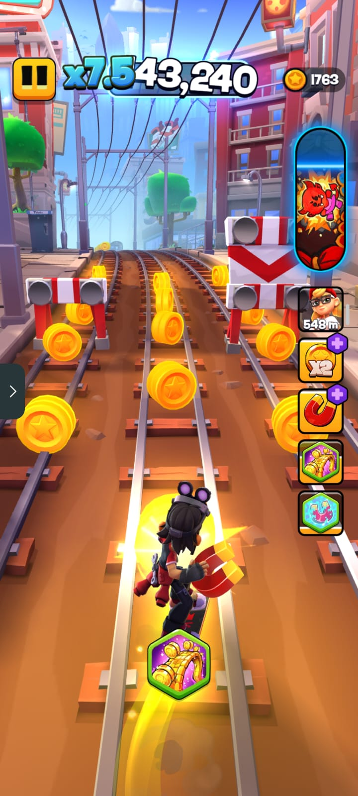
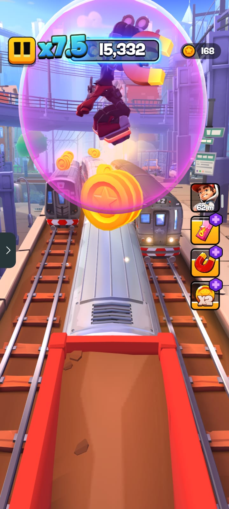
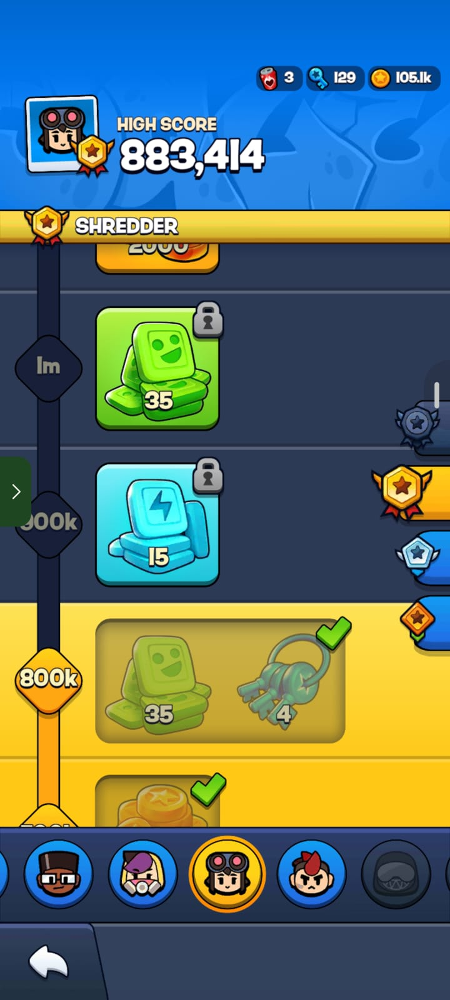
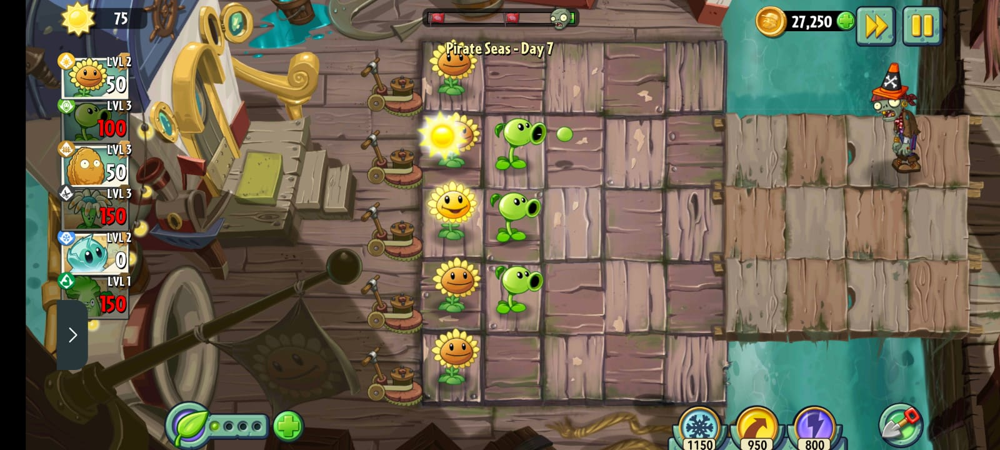
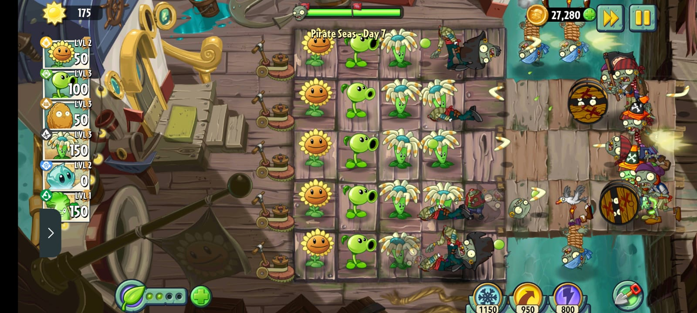
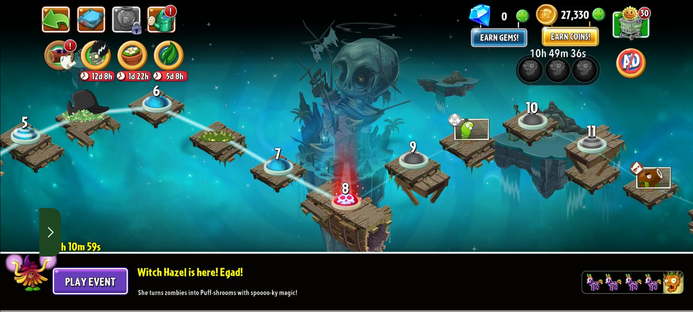
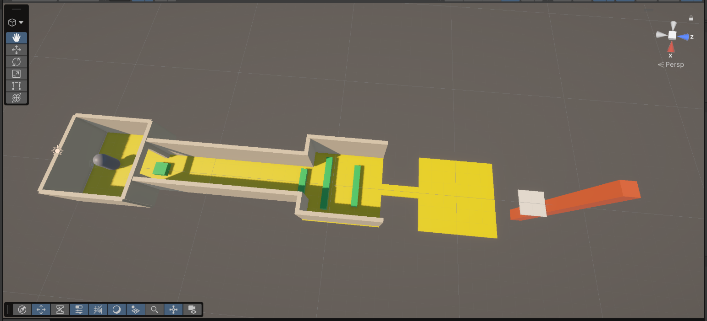
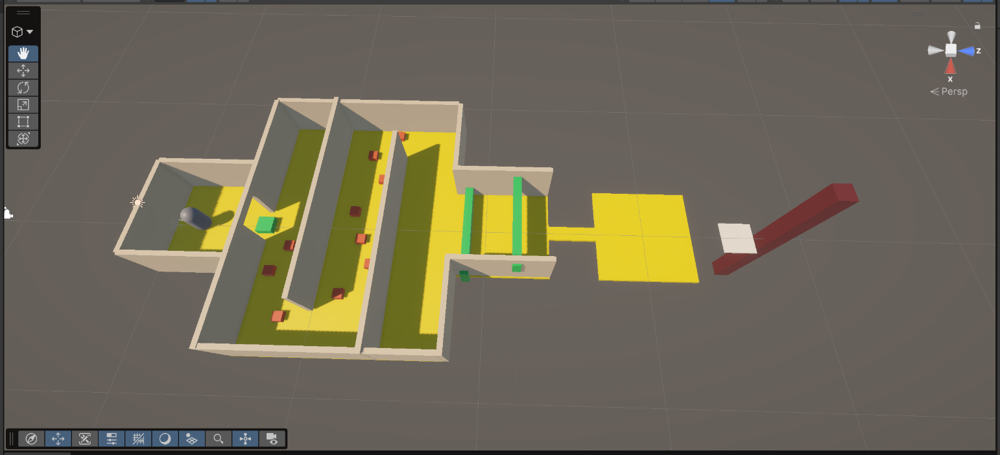
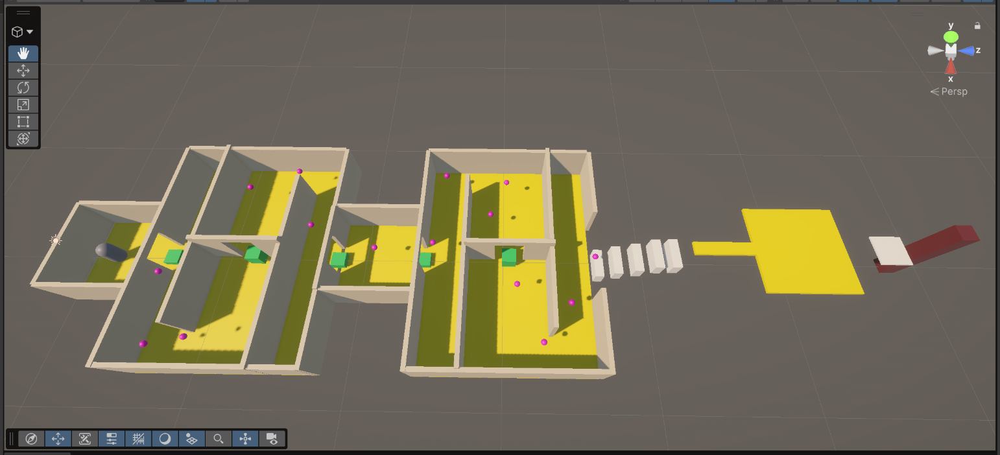
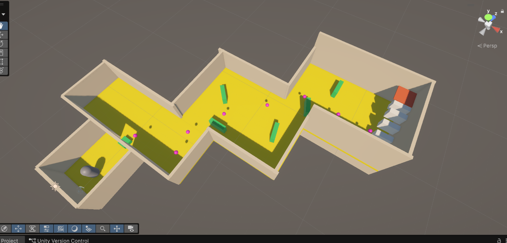

# CS464 Assignment 01 · Omer Abdullah · BSCS25135

## Game 1 · Subway Surfers City
- **Store link:** https://play.google.com/store/apps/details?id=com.sybogames.subway.surfers.game&hl=en&pli=1
- **Genre:** Endless Runner
- **I played:** I played for 45 minutes and achieved my personal highest score of 883414.

1. [M1, M2, M3] · Core gameplay like lane switching, jumping, sliding and collecting coins while avoiding obstacles.
2. [M4, M5] · Hoverboard and power-ups during a run, showing how these abilities helps the player to survive and improve performance.
3. [M6, M7] · High-score and/or progression screen showing the scoring system, missions and rewards etc that drives players to come back to the game.

| # | Mechanic | Dynamic | Aesthetic | Bartle type |
|---|---|---|---|---|
| M1 | Lane switching | Player switches between three lanes to avoid trains and obstacles. | Challenge | Achiever |
| M2 | Jumping and sliding | Player times jumps and slides to pass over or under obstacles. | Challenge, Sensation | Achiever |
| M3 | Coin collection | Player takes risks and changes lanes to collect coins while also avoiding obstacles. | Achievement | Achiever |
| M4 | Hoverboard | Player activates a hoverboard to gain temporary immunity and continue running after a collision. | Sensation, Challenge | Achiever |
| M5 | Power-ups | Player uses power ups such as coin magnets, bubble gum, drones and other boosts to collect more rewards and improve a run. | Sensation | Achiever |
| M6 | Scoring and multiplier | Player tries to achieve higher scores by surviving longer and increasing the score multiplier. | Achievement | Achiever |
| M7 | Missions and progression | Player completes objectives and unlocks rewards, characters and additional content. | Achievement, Discovery | Explorer |

**Aesthetic profile:** Subway Surfers City primarily focuses on Challenge, Sensation and Achievement. Challenge comes from avoiding increasingly difficult placements of obstacles and reacting quickly. Sensation comes from fast-paced movement, colourful environments and exciting gameplay. Achievement comes from beating personal records, collecting coins and completing missions.

**Player types**
- Primary: Achiever (acting × world), because M3, M6 and M7 encourage collecting rewards, improving high scores and completing objectives.
- Secondary: Explorer (interacting × world), because M7 encourages players to discover new content, districts, characters and gameplay features.

## Game 2 · Plants vs Zombies 2
- **Store link:** https://play.google.com/store/apps/details?id=com.ea.game.pvz2_row&hl=en
- **Genre:** Tower Defense
- **I played:** I played for 30 minutes. There is no traditional score system, but I am currently on Pirate Seas level 7.

1. [M1, M2, M3] · Core gameplay showing sun collection, plant selection and strategic placement of plants on the battlefield.
2. [M4, M5] · Gameplay showing plant cooldowns and different zombie waves that challenge the player's defensive strategy.
3. [M6, M7] · Plant Food ability orlevel progression screen showing special plant abilities and advancement through the game.

| # | Mechanic | Dynamic | Aesthetic | Bartle type |
|---|---|---|---|---|
| M1 | Sun collection | Player collects sum from flower or floating sun to be able to buy plants. | Strategy, Achievement | Achiever |
| M2 | Plant selection | Player chooses plants according to map layout type of zombies and power of plants. | Strategy, Challenge | Achiever |
| M3 | Grid-based plant placement | Player strategically places plants to maximize the chance of killing the zombies. | Strategy | Achiever |
| M4 | Plant cooldown | Player must wait for plants to be available to be planted again hence has to switch between plants in a wave to maximize kills. | Challenge | Achiever |
| M5 | Zombie waves | Player adapts their defensive strategy as different types of zombies approach in waves. | Challenge, Tension | Achiever |
| M6 | Plant Food | Player might use the leaf feature to accelerate the killing ability of a plant if he is loosing on some front. | Sensation, Power | Achiever |
| M7 | Level progression | Player completes levels to unlock new plants, worlds and increasingly difficult challenges. | Achievement, Discovery | Explorer |

**Aesthetic profile:** Plants vs Zombies 2 primarily focuses on Challenge, Strategy and Achievement. Challenge comes from defending against different zombie types and increasingly difficult waves. Strategy comes from managing limited resources and selecting the right plants and positions. Achievement comes from completing levels, unlocking plants and progressing through different worlds.

**Player types**
- Primary: Achiever (acting × world), because M1, M3, M5 and M7 reward efficient resource management, successful defence and completion of levels.
- Secondary: Explorer (interacting × world), because M2 and M7 encourage experimenting with different plant combinations and discovering new plants and worlds.
## Level blockouts
| Level | Screenshot | Its idea | Wayfinding tool |
|---|---|---|---|
| Level01 |  |we have to dodge obstacles and reach the goal | there is a tall pillar that we can look from everywhere in the map and we can follow that to reach the goal|
| Level02 |  |there is this maze with tiny obstacles and big ones too and objective is to reach the goal |wayfinding is same as before a tall pillar |
| Level03 |  |a more complicated maze where it is more challenging to traverse |we have 2 wayfindings here 1 is the same tall pillar and the other is xp/coins which a player can follow to reveal the goal |
| Level04 |  |this is filled with obstacles and we have to navigate thru them and reach the goal |this only uses xp/coins |
